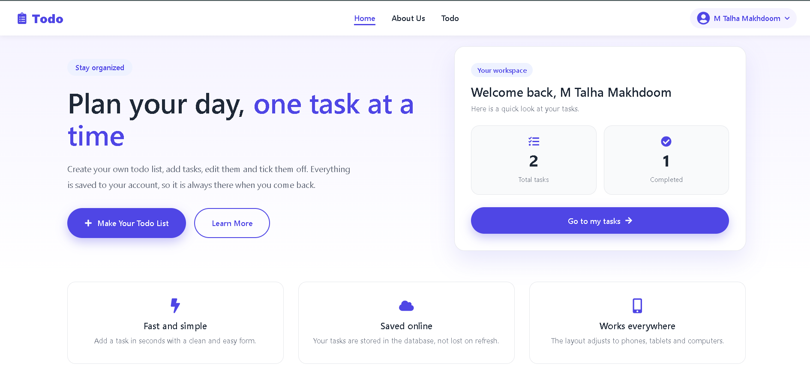
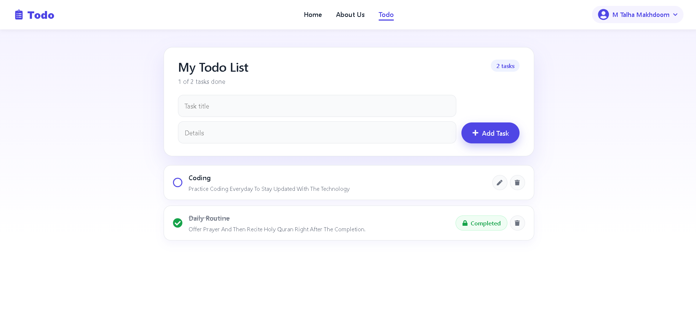
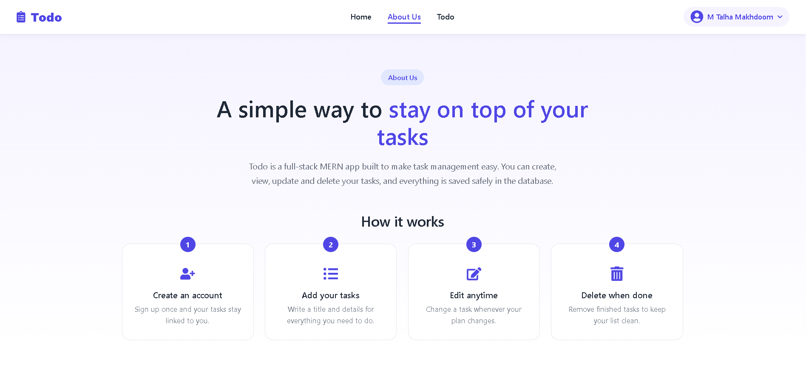
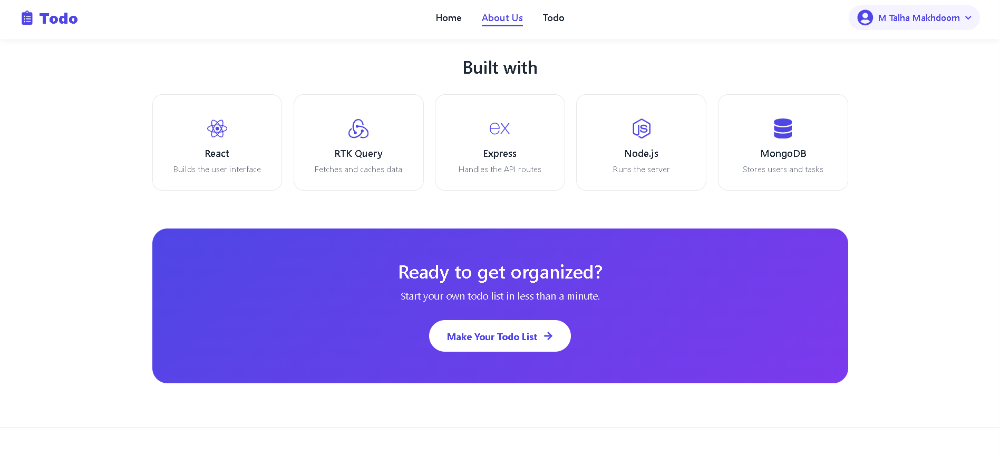
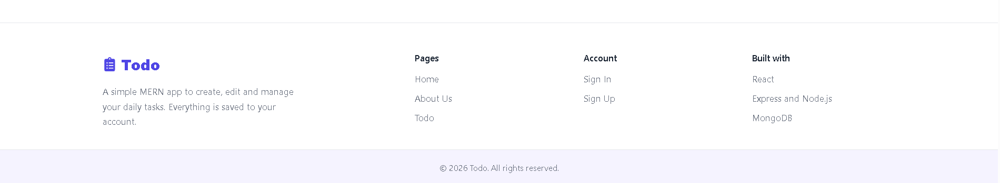

# MERN TODO

A full-stack task management application built with MongoDB, Express, React, and Node.js. Create an account, sign in, and organize tasks through a React interface backed by a REST API.

## Application Preview

### Home & Dashboard

A welcoming home page with a personal task summary and quick access to the workspace.



### Task Management

Create tasks, edit details, and view completed items in one workspace.



### About the Project

An overview of the application and its task management workflow.



### Technology & Call to Action



### Footer & Navigation



## Features

- User registration and sign-in with bcrypt password hashing.
- Create tasks with a title and description.
- View, edit, and delete tasks associated with a user.
- Mark tasks as completed, with completion indicators saved in the browser.
- Home, About, registration, sign-in, and task management pages.
- Toast notifications for feedback on user actions.

## Technology Stack

<p>
  
  
  
  
  
  
  
  
  
</p>


| Layer | Technologies |
| --- | --- |
| Frontend | React, Vite, React Router, CSS |
| UI utilities | React Icons, React Toastify |
| Backend | Node.js, Express |
| Database | MongoDB, Mongoose |
| Development | Nodemon, ESLint |
| Configuration | dotenv, CORS |

## Project Structure

```text
web-dev-projects/
└── MERN TODO/
    ├── backend/
    │   ├── connection/
    │   ├── models/
    │   ├── routes/
    │   ├── index.js
    │   └── package.json
    ├── frontend/
    │   └── tofo-project/
    │       ├── public/
    │       ├── src/
    │       │   ├── about/
    │       │   ├── assets/
    │       │   ├── components/
    │       │   ├── footer/
    │       │   ├── signup/
    │       │   ├── api.js
    │       │   ├── App.jsx
    │       │   └── main.jsx
    │       └── package.json
    ├── docs/
    │   └── screenshots/
    ├── .gitignore
    └── README.md
```

## Getting Started

### Prerequisites

- A Node.js version compatible with the project's Vite dependency and npm.
- MongoDB running locally, or a MongoDB Atlas connection string.
- Git.

### 1. Clone the repository

```bash
git clone https://github.com/talha0603/web-dev-projects.git
cd "web-dev-projects/MERN TODO"
```

If the repository is already on your computer, open its `MERN TODO` directory instead.

### 2. Configure and start the backend

```bash
cd backend
npm install
```

Create a file named `.env` inside `backend`:

```dotenv
MONGO_URI=mongodb://127.0.0.1:27017/mern_todo
PORT=7000
```

For MongoDB Atlas, replace `MONGO_URI` with your own connection string. Keep real credentials in your local `.env` file and exclude it from Git.

Start the API:

```bash
npm run dev
```

The API runs at `http://localhost:7000` by default. Opening that address should display `Todo List App`. Check the terminal for `Connected To MongoDB!` to confirm the database connection.

### 3. Start the frontend

Open a second terminal from the `MERN TODO` directory:

```bash
cd frontend/tofo-project
npm install
npm run dev
```

Open `http://localhost:5173` in your browser. Keep both terminals running.

### Local Configuration

The frontend API base URL is currently set to `http://localhost:7000/api` in `frontend/tofo-project/src/api.js`. The backend allows requests from `http://localhost:5173` in `backend/index.js`.

If you change the ports or deploy the application, update these values to match your environment. If Vite selects a different port because 5173 is busy, free port 5173 or update the backend CORS origin.

## Usage

1. Register an account on the Sign Up page.
2. Sign in using your email and password.
3. Open the task page and add a title and description.
4. Edit or delete tasks as needed.
5. Mark a task complete when finished. The current interface locks completed tasks against editing and does not offer an undo action.

Task content is stored in MongoDB. Completion indicators are stored in browser localStorage, so they do not sync across browsers or devices and can disappear when browser storage is cleared.

## API Reference

Base URL: `http://localhost:7000`

| Method | Endpoint | Purpose | JSON body |
| --- | --- | --- | --- |
| GET | `/` | API welcome message | — |
| POST | `/api/v1/register` | Register a user | `username`, `email`, `password` |
| POST | `/api/v1/signin` | Sign in | `email`, `password` |
| POST | `/api/v2/addTask` | Create a task | `title`, `body`, `email` |
| GET | `/api/v2/getTasks/:id` | List tasks for a user ID | — |
| PUT | `/api/v2/updateTask/:id` | Update a task ID | `title`, `body`, `email` |
| DELETE | `/api/v2/deleteTask/:id` | Delete a task ID | `email` |

## Available Commands

Run commands inside the corresponding application directory.

| Directory | Command | Purpose |
| --- | --- | --- |
| `backend` | `npm run dev` | Start the API with Nodemon |
| `frontend/tofo-project` | `npm run dev` | Start the Vite development server |
| `frontend/tofo-project` | `npm run build` | Generate a frontend production build |
| `frontend/tofo-project` | `npm run preview` | Preview the frontend build locally |
| `frontend/tofo-project` | `npm run lint` | Run ESLint |

## Current Limitations

This project implements basic sign-in but does not currently issue or validate authentication tokens or server sessions for task requests. Task routes use client-supplied user IDs or email addresses. Server-side authentication and authorization are needed before using it with real users in a public deployment.

## Author

**M Talha Makhdoom** — [GitHub: talha0603](https://github.com/talha0603)

This project is part of the [web-dev-projects](https://github.com/talha0603/web-dev-projects) collection.


